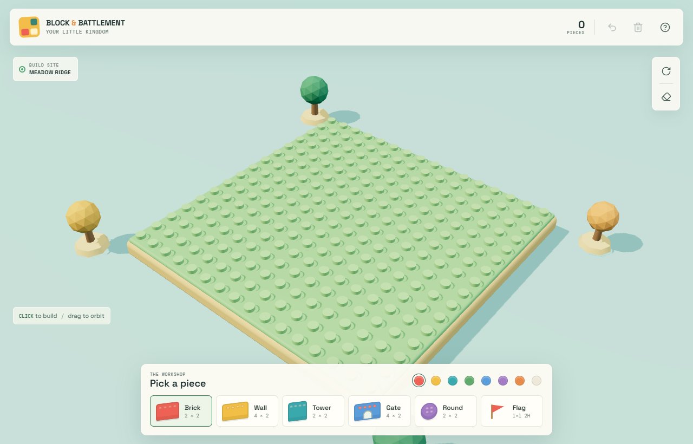
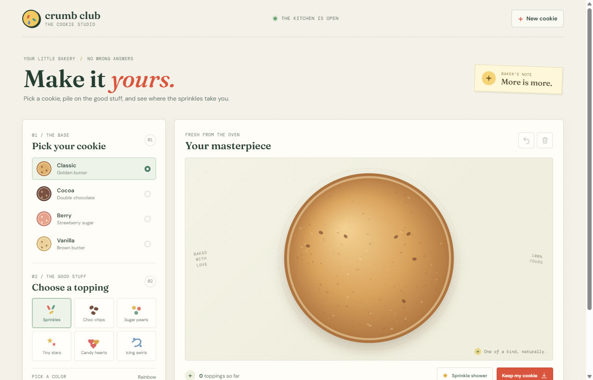
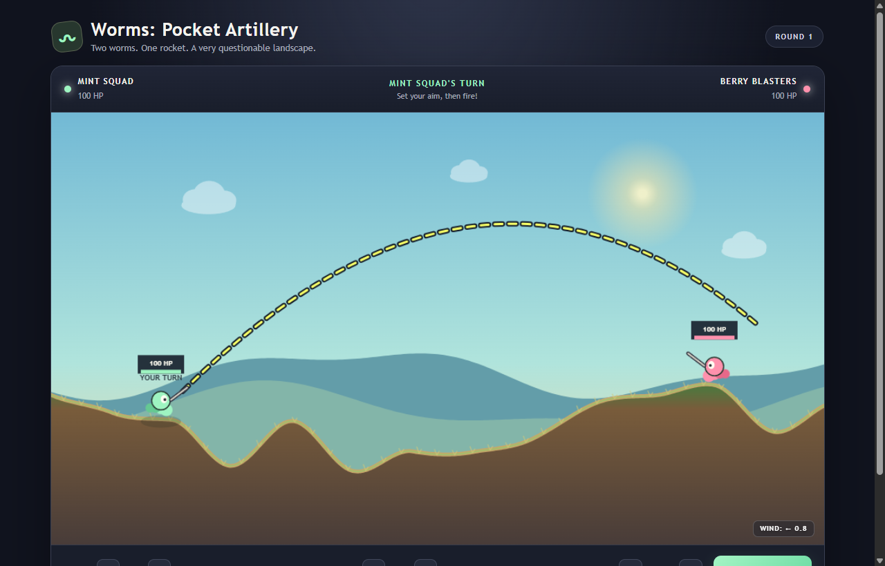
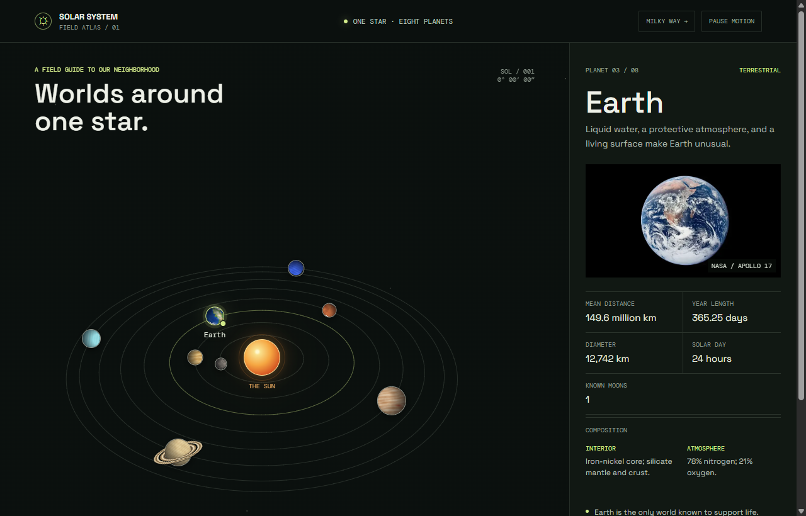

# Games & Learn

A small portfolio page linking to browser games and experiments by Gavin.

**Website:** <https://guantong.github.io/index/>

## Games

### Block & Battlement

Build a little 3D castle by placing colorful bricks, walls, towers, gates, and other pieces on a tiny kingdom.

[Play the game](https://guantong.github.io/build-a-castle/)

### Cookie Lab

Choose a cookie base, add toppings and colors, then save your freshly decorated creation.

[Play the game](https://guantong.github.io/cookie-lab/)

### Worms: Pocket Artillery

A turn-based artillery duel. Set your angle and power, account for the wind, and launch rockets across the landscape.

[Play the game](https://guantong.github.io/worms-clone/)

### Solar System Field Atlas

Explore an interactive map of the eight planets and a field guide to our solar neighborhood.

[Explore the atlas](https://guantong.github.io/solar-system/)

## Preview locally

Open `index.html` in a browser. The page is static and has no build step or dependencies; screenshots are stored in `assets/`.

## Deploy

The [GitHub Pages workflow](.github/workflows/deploy.yml) deploys the site when changes are pushed to `main`. It can also be started manually from the repository's Actions tab. The workflow publishes `index.html` and `assets/` without including other repository files.

For the first deployment, set the repository's **Settings → Pages → Build and deployment → Source** to **GitHub Actions**.
